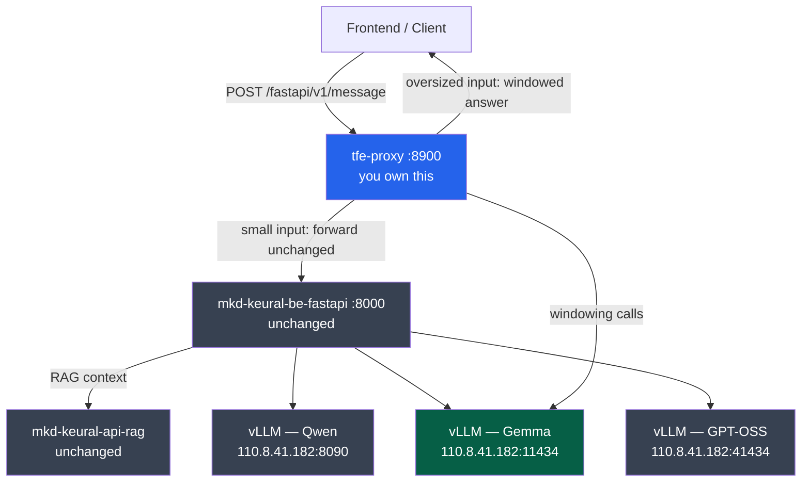
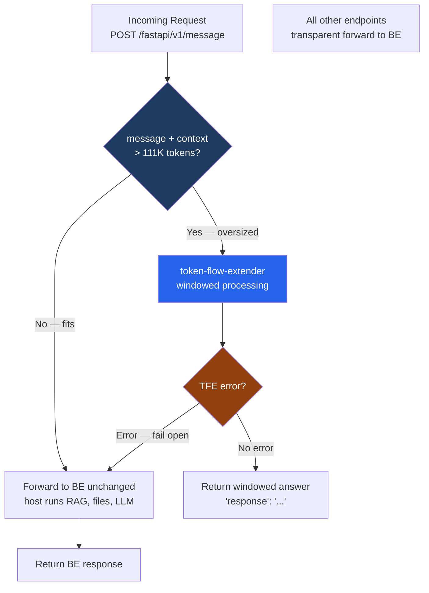
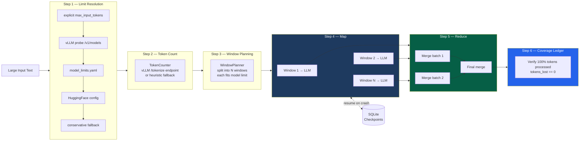
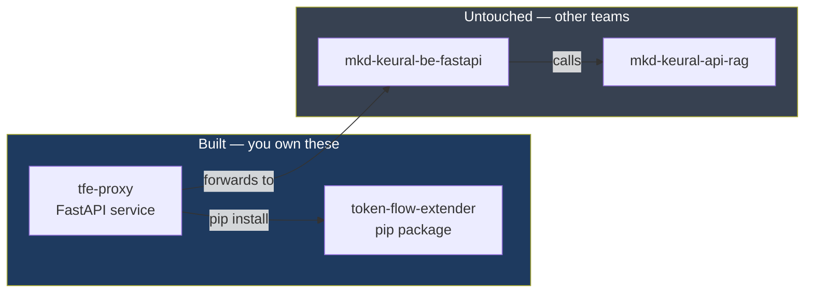

# Architecture — User Input Context Limit Solution

## 1. System Overview

---

## 2. tfe-proxy Request Flow

---

## 3. token-flow-extender Pipeline

---

## 4. What Was Built vs What Was Untouched

---

## 5. Key Numbers

| Component | Metric |
|---|---|
| token-flow-extender tests | 64 passing |
| Core coverage | 93% |
| Bugs found in host platform | 15 (see AUDIT_REPORT.md) |
| Models supported | Gemma 131K · Qwen 496K · GPT-OSS 120K · Nano 270K · Keural 768 |
| Proxy token threshold (Gemma) | 111,411 tokens |
| Host repos modified | 0 |
